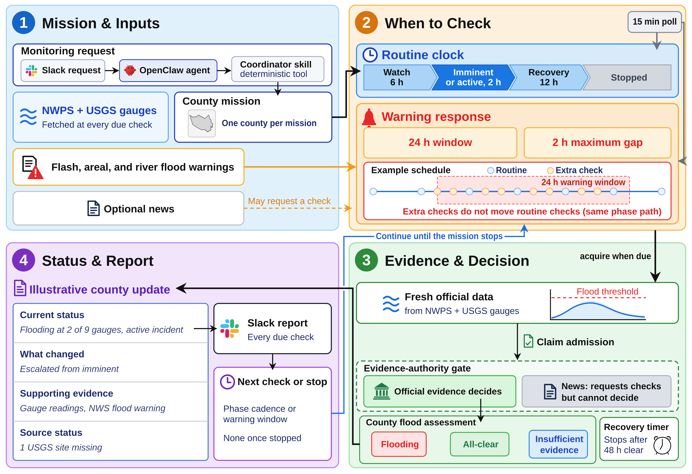

# FloodSentinel

Code, frozen replay corpora, results, and figure scripts for the manuscript *FloodSentinel: An Agentic AI Framework for Active Information Acquisition and Evidence Governance in Flood Monitoring* (Xiao, Murugan, Brody, and Mostafavi; submitted to Computers, Environment and Urban Systems, 2026). A preprint link and citation will be added when the arXiv version is available. The frozen corpora, results, protocols, and the NOAA Storm Events files used here are also archived as a dataset at <https://huggingface.co/datasets/Ymx1025/floodsentinel>.

FloodSentinel is a deterministic county-scale flood monitor. An event-phase model sets how often it acquires official gauge observations and warnings; official flood warnings (and, in an evaluated extension, admitted news reports) may request an acquisition; only official evidence, gauge observations and, in live operation, official warning claims, may set the flood verdict, alert level, phase, all-clear, and termination. In the replay studies the decision evidence is gauge observations alone, and archived warnings only request acquisitions. The manuscript evaluates its acquisition policies in three historical replay studies under frozen analysis protocols, with post-hoc analyses that explain the results. Everything needed to read, check, and regenerate those results is in this repository.



*FloodSentinel's acquisition and reporting workflow, read clockwise from the top left: the monitoring request and inputs (1), the phase-set schedule and warning response (2), evidence admission and the county assessment (3), and the report and next check (4). The blue loop returns to scheduling until the mission stops. Report contents are illustrative; the county shown is Harris County, Texas.*

## Name

The Python package and its internal strings use the project's development name, "Disaster Sentinel", and that name appears in nine files under `watcher/`. Those files belong to the implementation set whose SHA-256 hashes the study manifests record (see `REPRODUCIBILITY.md`), so they are shipped byte-identical rather than renamed. FloodSentinel and Disaster Sentinel refer to the same code. Environment variables keep the `SENTINEL_` prefix and Neo4j IRIs keep the `ds:` prefix for the same reason.

## Layout

| Path | Contents |
|---|---|
| `watcher/` | The runtime: acquisition, claim extraction and admission, the phase engine, the verification trigger, replay, report formatting, and tests. `watcher/cli.py` holds the monitoring cycle; `watcher/replay.py` provides the as-of virtual clock every timing result rests on. |
| `skills/county-flood-data/` | Official-source fetch package (NOAA NWPS, USGS NWIS, NWS alerts) and the frozen NWPS gauge registry. |
| `skills/flood-article-detector/` | The news detector used unchanged in the news replays. |
| `skills/mission-bootstrap/` | County and FIPS resolution imported by the CLI. |
| `skills/*/SKILL.md`, `bin/` | The OpenClaw skill contracts and shell wrappers through which a Slack request reaches the runtime. Production host paths are replaced by `<workspace>` and the Slack channel by `<channel-id>`. |
| `eval/` | The evaluation harness: replay driver, hydrologic reference, fixed-clock and budget-matched comparators, trigger streams, study generators, post-hoc analyses, protocols, reports, and tests. Never used in production. |
| `eval/corpus/` | Frozen gauge corpora, warning (VTEC) trigger corpora, selection artifacts, and manifests for Study 1 (`study/`), Study 2 (`study_v3/`), Study 3 (`study_v4/`), and the news-verification extension (`study_v5/`). |
| `eval/results/` | Sources of record: `study_v2/` (Study 1), `study_v3_hybrid_rev2/` (Study 2), `study_v4_additive/` (Study 3), `study_v5_ontology/` (credibility and news verification), `belief_news_null.json` (admission ablation), `sensitivity.json` (Study 1 sensitivities), `deployment_summary.json` and `deployment_cost/` (deployment audit), and the post-hoc analyses `post_hoc_comparators/`, `robustness_checks/`, `posthoc_bootstrap/`, `posthoc_storm_events/`, `posthoc_phase_occupancy/`. The development grids `study_v3_dev/` and `study_v4_dev/` record how the trigger settings were chosen. |
| `figures/` | The figure scripts, the figure files the manuscript uses, and the source of the hand-drawn architecture figure (`overview.svg`, exported as `overview.png`). |

Study numbering in the manuscript maps to internal version names as follows: Study 1 is v2, Study 2 is v3, Study 3 is v4, and the evidence extension is v5.

## Environment

Tested with Python 3.14. The runtime needs `requirements.txt`; the evaluation harness, tests, and figures additionally need `requirements-eval.txt`.

```bash
python3 -m venv .venv && . .venv/bin/activate
pip install -r requirements.txt -r requirements-eval.txt
```

Replay, the post-hoc analyses, the tests, and the figures need no network access, no Neo4j, and no Slack. Only the live monitoring cycle (`bin/run-coordinator`) needs a reachable Neo4j and an OpenClaw gateway; its environment variables are read in `watcher/config.py`.

## Tests

```bash
pytest watcher/tests eval/tests skills/county-flood-data/county_flood/tests skills/flood-article-detector/tests -q
```

Expected: 400 passed, 5 subtests passed.

## Reproducing the manuscript

Every command runs from the repository root. Manuscript elements are named rather than numbered because numbering can change between manuscript versions. `REPRODUCIBILITY.md` lists what each command must print or produce.

| Manuscript element | Command | Reads | Writes |
|---|---|---|---|
| Study 1 outcome table and acquisition--delay figure | `python3 figures/make_results_figure.py --output-dir <dir>` | `eval/results/study_v2/` | the Study 1 figure |
| Architecture figure | drawn by hand; not generated | n/a | `figures/overview.svg` (source), `figures/overview.png` |
| Study 2 per-county-event figure | `python3 eval/figures_v3.py` | `eval/results/study_v3_hybrid_rev2/` | `figures/fig_verification_trigger.*` |
| Study 3 per-county-event figure | `python3 eval/figures_v3.py --v4` | `eval/results/study_v4_additive/` | `figures/fig_verification_trigger_v4.*` |
| Uniform-clock and warning-anticipation tables | `python3 eval/post_hoc_comparators.py` | Study 2 and 3 results | `eval/results/post_hoc_comparators/` |
| Start-offset and phase-free control table and paragraphs | `python3 eval/robustness_checks.py` | Study 3 corpora and results | `eval/results/robustness_checks/` (24 offsets by 3 policies by 24 county-events; long) |
| Paired bootstrap intervals in the post-hoc results | `python3 eval/posthoc_bootstrap_intervals.py` | the above | `eval/results/posthoc_bootstrap/summary.*` |
| Study-inputs table | `python3 eval/posthoc_data_statistics.py` | corpora, results, and the GDELT news corpora (see below) | `eval/results/posthoc_bootstrap/data_statistics.md` |
| County-event map | `python3 figures/make_county_map.py --out-dir <dir>` | the three study manifests; downloads Census 2023 boundary files on first use | the map |
| Three-case mechanism figure and table | `python3 figures/make_mechanism_figure.py --report --output-dir <dir>` | frozen corpora and results; replays three county-events and fails closed unless they match the stored summaries | the mechanism figure and the report behind the mechanism table |
| Phase-occupancy sentences (Study 3 results) | `python3 eval/posthoc_phase_occupancy.py` | `eval/results/study_v4_additive/` | `eval/results/posthoc_phase_occupancy/` |
| Comparison with NOAA Storm Events | `python3 eval/posthoc_storm_events.py --storm-dir <dir>` | Study 2 and 3 corpora and results; the Storm Events bulk files (see below); replays every county-event and fails closed unless each replay matches its stored summary | `eval/results/posthoc_storm_events/` (long) |
| Deployment paragraphs | `python3 eval/deployment_cost.py` | the raw cron log (not included, see below) | `eval/results/deployment_cost/` |
| Study 3 itself | `python3 eval/run_study_v4.py --manifest eval/corpus/study_v4/manifest.json --out-dir <empty-dir>` | Study 3 corpora | a fresh copy of `eval/results/study_v4_additive/` (long) |

The post-hoc scripts write into their fixed output directories under `eval/results/`; to compare against the shipped files, move the shipped directory aside first.

## News corpora

The Harris County admission ablation and the news-verification extension read GDELT Global Knowledge Graph corpora that are not included (337 MB, seven files matching `eval/corpus/**/*_gdelt.json`). They regenerate from the immutable GDELT archive with `eval/news_gdelt.py`. The exact Harris command, including place terms and date window, is recorded in `eval/corpus/study/belief_news_manifest.json`; the six extension corpora follow the method fixed in `eval/ONTOLOGY_STUDY_PROTOCOL.md` (sweep from one day before each county's analysis window to its end, place terms `"<County> County, <State>"` and `"<county seat>, <State>"`, or `"Caguas, Puerto Rico"`). The SHA-256 of every corpus is recorded in `belief_news_null.json` or in the `inputs` of `eval/results/study_v5_ontology/t2_gap_study.json`, so a regenerated corpus can be verified. The frozen results of both experiments are included and do not need the corpora to be read.

## Storm Events files

The Storm Events comparison reads nine NOAA NCEI "details" bulk files, 2016 to 2024, which are not shipped. Their exact names and SHA-256 hashes are recorded in `eval/results/posthoc_storm_events/summary.json`. NCEI replaces these files when it revises the database, so a later download may carry a newer creation date and different contents. The recorded versions are archived in the `storm_events/` folder of the [Hugging Face dataset](https://huggingface.co/datasets/Ymx1025/floodsentinel), and were still available from NCEI on 15 October 2026:

```bash
mkdir -p storm && cd storm
for f in d2016_c20260323 d2017_c20260519 d2018_c20260323 d2019_c20260323 d2020_c20260323 d2021_c20260323 d2022_c20260625 d2023_c20260323 d2024_c20260728; do
  curl -O https://www.ncei.noaa.gov/pub/data/swdi/stormevents/csvfiles/StormEvents_details-ftp_v1.0_$f.csv.gz
done
```

## Deployment log

The 25.6-day production log behind the deployment audit (86 MB of concatenated JSON) is not included because it records host paths and mission identifiers. `eval/results/deployment_summary.json` records its SHA-256 (`403fe1c3d70cec8246b5157444684ab6ad79eea512ddcb8270b4066e54756150`) and the derived counts the manuscript reports; the log is available from the authors on request.

## License

MIT; see `LICENSE`. Gauge observations and thresholds originate from public USGS and NOAA services and warning products from the Iowa Environmental Mesonet VTEC archive; each corpus manifest records its source and retrieval window.
